# AI-Assisted Steel Surface Inspection: Deep Learning Based Defect Classification, Localization, and Explainability

[](https://www.python.org/)
[](https://www.tensorflow.org/)
[](https://keras.io/)
[](https://github.com/ultralytics/ultralytics)
[](https://streamlit.io/)
[](http://faculty.neu.edu.cn/yunhyan/NEU_surface_defect_database.html)
[](#61-classification-models-comparison)
[](#64-yolo11n-object-localization-performance)

An end-to-end computer vision and explainable artificial intelligence (XAI) system engineered for automated hot-rolled steel strip surface defect inspection. Built on the benchmark **NEU-DET (Northeastern University Surface Defect Database)**, this project integrates fine-tuned transfer learning (**MobileNetV2** and **ResNet50**), real-time bounding box defect detection (**YOLO11n**), gradient-weighted class activation mapping (**Grad-CAM**), and an interactive **Streamlit** inspection dashboard.

---

## Table of Contents

- [1. Project Overview](#1-project-overview)
  - [1.1 Problem Statement & Industrial Motivation](#11-problem-statement-industrial-motivation)
  - [1.2 Proposed Hybrid Solution](#12-proposed-hybrid-solution)
  - [1.3 Target Users & Practical Applications](#13-target-users-practical-applications)
  - [1.4 Key Objectives & System Capabilities](#14-key-objectives-system-capabilities)
- [2. System Architecture & Technical Workflow](#2-system-architecture-technical-workflow)
  - [2.1 Architectural Diagram](#21-architectural-diagram)
  - [2.2 End-to-End Processing Flowchart](#22-end-to-end-processing-flowchart)
  - [2.3 Core Pipeline Modules & Data Flow](#23-core-pipeline-modules-data-flow)
- [3. Technology Stack](#3-technology-stack)
- [4. Dataset Description & Preprocessing](#4-dataset-description-preprocessing)
  - [4.1 Dataset Overview & Defect Classes](#41-dataset-overview-defect-classes)
  - [4.2 Dataset Splits & Bounding Box Distribution](#42-dataset-splits-bounding-box-distribution)
  - [4.3 Pascal VOC to YOLO Format Conversion](#43-pascal-voc-to-yolo-format-conversion)
  - [4.4 Dataset Visualizations](#44-dataset-visualizations)
- [5. Machine Learning Methodology](#5-machine-learning-methodology)
  - [5.1 Defect Classification Backbone: MobileNetV2](#51-defect-classification-backbone-mobilenetv2)
  - [5.2 Comparative Classification Baseline: ResNet50](#52-comparative-classification-baseline-resnet50)
  - [5.3 Object Localization Engine: YOLO11n](#53-object-localization-engine-yolo11n)
  - [5.4 Explainable AI (XAI): Grad-CAM Implementation](#54-explainable-ai-xai-grad-cam-implementation)
  - [5.5 Architecture Rationale: Why a Tri-Component System?](#55-architecture-rationale-why-a-tri-component-system)
- [6. Experimental Results & Quantitative Evaluation](#6-experimental-results-quantitative-evaluation)
  - [6.1 Classification Models Comparison](#61-classification-models-comparison)
  - [6.2 MobileNetV2 Detailed Evaluation & Confusion Matrix](#62-mobilenetv2-detailed-evaluation-confusion-matrix)
  - [6.3 ResNet50 Detailed Evaluation & Confusion Matrix](#63-resnet50-detailed-evaluation-confusion-matrix)
  - [6.4 YOLO11n Object Localization Performance](#64-yolo11n-object-localization-performance)
- [7. In-Depth Error Analysis: The Crazing Defect Challenge](#7-in-depth-error-analysis-the-crazing-defect-challenge)
  - [7.1 Empirical Analysis of Zero-Prediction Cases](#71-empirical-analysis-of-zero-prediction-cases)
  - [7.2 Ground Truth vs. Prediction Discrepancy](#72-ground-truth-vs-prediction-discrepancy)
  - [7.3 Visual Failure Cases](#73-visual-failure-cases)
  - [7.4 Complementary Role of Grad-CAM in Resolving Failures](#74-complementary-role-of-grad-cam-in-resolving-failures)
- [8. Application Features & User Guide](#8-application-features-user-guide)
  - [8.1 Interactive Streamlit Application (`app.py`)](#81-interactive-streamlit-application-apppy)
  - [8.2 Inspection Workflow Demonstration](#82-inspection-workflow-demonstration)
  - [8.3 Automated JSON Inspection Report Export](#83-automated-json-inspection-report-export)
  - [8.4 Sample Defect Localizations](#84-sample-defect-localizations)
- [9. Explainability Showcase (Grad-CAM)](#9-explainability-showcase-grad-cam)
- [10. Project Directory Structure](#10-project-directory-structure)
- [11. Installation & Environment Setup](#11-installation-environment-setup)
  - [11.1 Prerequisites](#111-prerequisites)
  - [11.2 Environment Configuration](#112-environment-configuration)
  - [11.3 Dependency Installation](#113-dependency-installation)
  - [11.4 Pretrained Weights & Dataset Setup](#114-pretrained-weights-dataset-setup)
- [12. How to Run the Project](#12-how-to-run-the-project)
  - [12.1 Launching the Interactive Web Application](#121-launching-the-interactive-web-application)
  - [12.2 Executing the Standalone Inspection Pipeline](#122-executing-the-standalone-inspection-pipeline)
  - [12.3 Retraining Models](#123-retraining-models)
  - [12.4 Running Evaluation & Verification Scripts](#124-running-evaluation-verification-scripts)
- [13. System Scope, Limitations & Future Roadmap](#13-system-scope-limitations-future-roadmap)
  - [13.1 Operational Scope & Metallurgical Disclaimer](#131-operational-scope-metallurgical-disclaimer)
  - [13.2 Known Limitations](#132-known-limitations)
  - [13.3 Future Roadmap](#133-future-roadmap)
- [14. Troubleshooting & FAQ](#14-troubleshooting-faq)
- [15. References & Acknowledgments](#15-references-acknowledgments)

---

## 1. Project Overview

### 1.1 Problem Statement & Industrial Motivation

Hot-rolled steel strips form the foundational structural material for automotive bodies, naval hulls, construction beams, and heavy machinery. During high-temperature rolling, cooling, and mechanical processing, steel surfaces frequently suffer from severe structural and cosmetic defects caused by:
- Non-metallic impurities entrapped in molten steel (**Inclusions**)
- High-temperature oxidation and hydraulic descaling malfunctions (**Rolled-in Scale**)
- Thermal fatigue and surface micro-cracking from roller wear (**Crazing**)
- Chemical corrosion, roller indentations, and surface abrasions (**Pitted Surfaces, Patches, Scratches**)

Traditional manual visual inspection conducted by human quality inspectors is slow, subjective, hazardous, and susceptible to severe fatigue. Furthermore, standard single-model computer vision architectures struggle to address the diversity of steel defects: some defects manifest as distinct localized objects with sharp boundaries (e.g., inclusions and patches), while others manifest as subtle, diffuse background micro-textures spanning broad regions (e.g., crazing networks).

### 1.2 Proposed Hybrid Solution

To overcome the shortcomings of isolated classification or isolated object detection, this project implements a **synergistic tri-component inspection framework**:
1. **Global Defect Classification (`MobileNetV2` & `ResNet50`)**: Classifies the steel strip image into one of 6 defect categories with high certainty and comprehensive probability distribution modeling.
2. **Local Object Bounding Box Detection (`YOLO11n`)**: Pinpoints discrete, visible defect instances using oriented bounding boxes, coordinates, and localization confidence scores.
3. **Visual Saliency Explainability (`Grad-CAM`)**: Generates gradient-weighted class activation heatmaps showing exactly which surface textures and spatial features drove the deep learning classifier's decision.

### 1.3 Target Users & Practical Applications

- **Steel Rolling Mills & Metal Fabricators**: Inline or quality-assurance station automated visual sorting.
- **Automotive & Aerospace Quality Control**: Inbound sheet metal verification prior to stamping and welding.
- **Industrial Metrology Engineers & Auditors**: Explainable audit trails and structured JSON compliance reports for rejected coils.
- **Academic & Applied ML Researchers**: A benchmark implementation contrasting single-stage object detection vs. transfer learning on fine-grained industrial surface defects.

### 1.4 Key Objectives & System Capabilities

- Achieve $>98\%$ top-1 classification accuracy across 6 challenging industrial defect categories.
- Provide sub-second inference on standard CPU hardware without mandatory high-end GPU clusters.
- Establish an explainable AI pipeline that renders deep neural network predictions interpretable and auditable to metallurgical personnel.
- Quantitatively diagnose failure modes (such as YOLO's documented under-detection of micro-crack crazing) and explain how multi-model fusion resolves them.
- Package the entire workflow into an intuitive, interactive Streamlit interface capable of real-time image analysis and exportable reporting.

---

## 2. System Architecture & Technical Workflow

### 2.1 Architectural Diagram

```mermaid
graph TB
    subgraph UI["Streamlit User Interface (app.py)"]
        A[User Uploads Steel Surface Image<br/>JPG / PNG / JPEG]
        DisplayMetric[Metric Cards & Probabilities Bar Chart]
        DisplayVisuals[Detection Overlay & Grad-CAM Display]
        ExportJSON[Downloadable JSON Inspection Report]
    end

    subgraph Core["Final Inspection Pipeline (final_inspection_pipeline.py)"]
        Preproc[Image Preprocessing<br/>BGR to RGB / 224x224 / [0, 1] Normalization]
        
        subgraph ClassificationBranch["1. Classification Branch"]
            MNet[MobileNetV2 Transfer Learning<br/>ImageNet Backbone + GAP + Dropout + Softmax]
            ClassOut[Predicted Defect & 6-Class Probability Vector]
        end

        subgraph DetectionBranch["2. Localization Branch"]
            YoloModel[YOLO11n Nano Object Detector<br/>Confidence Threshold = 0.10 / imgsz = 224]
            BoxFilter[Bounding Boxes & Coordinate Extraction]
        end

        subgraph ExplainabilityBranch["3. Explainability Branch"]
            GradCamEngine[Grad-CAM Engine<br/>Target Layer: Conv_1 / Gradient Backpropagation]
            HeatmapGen[Jet Colormap Overlay Generation]
        end
        
        ReportGen[Report Aggregator<br/>Results JSON Synthesis & Visual Export]
    end

    A --> Preproc
    Preproc --> MNet
    Preproc --> YoloModel
    Preproc --> GradCamEngine
    MNet --> ClassOut
    YoloModel --> BoxFilter
    ClassOut --> GradCamEngine
    GradCamEngine --> HeatmapGen
    ClassOut --> ReportGen
    BoxFilter --> ReportGen
    HeatmapGen --> ReportGen
    ReportGen --> DisplayMetric
    ReportGen --> DisplayVisuals
    ReportGen --> ExportJSON
```

### 2.2 End-to-End Processing Flowchart

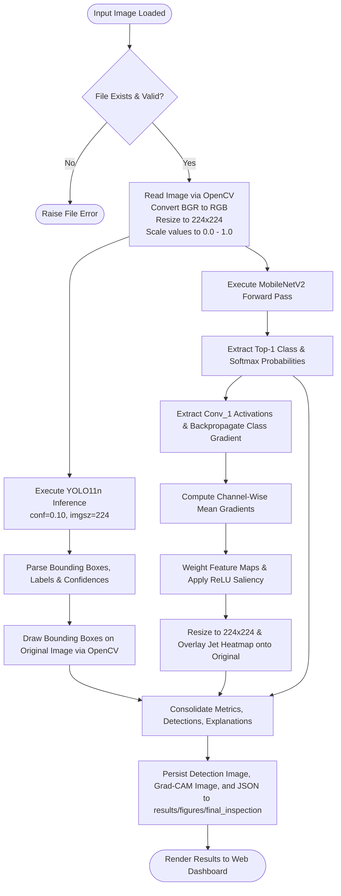

### 2.3 Core Pipeline Modules & Data Flow

1. **Input Ingestion & Preprocessing (`src/final_inspection_pipeline.py`)**:
   - Images are loaded from file or temporary Streamlit upload buffer using OpenCV.
   - Preprocessing resizes input to $(224 \times 224)$ pixels and scales pixel intensities to $[0.0, 1.0]$, strictly matching the training transformation applied in `src/train_mobilenetv2.py`.
2. **Parallel Inference**:
   - **MobileNetV2** processes the tensor batch $(1, 224, 224, 3)$ and outputs a 6-element probability vector $\mathbf{p} \in [0, 1]^6$.
   - **YOLO11n** processes the image at `imgsz=224` with a lowered operational confidence threshold of `conf=0.10` to capture subtle defect signatures.
3. **Gradient-Based Feature Attribution**:
   - The final convolutional layer of MobileNetV2 (`Conv_1`) produces feature maps $A^k \in \mathbb{R}^{7 \times 7}$.
   - Gradients of the predicted class score $y^c$ with respect to feature maps $\frac{\partial y^c}{\partial A^k}$ are pooled via Global Average Pooling to compute neuron importance weights $\alpha_k^c$.
   - The weighted linear combination followed by ReLU yields the 2D saliency map, which is upsampled to $224 \times 224$, color-mapped using OpenCV's `COLORMAP_JET`, and alpha-blended ($55\%$ original $+ 45\%$ heatmap).
4. **Structured JSON Assembly**:
   - Aggregates classification output, bounding box coordinates $[x_1, y_1, x_2, y_2]$, explainability metadata, and metallurgical disclaimer into a structured report saved to disk and exposed for one-click download.

---

## 3. Technology Stack

| Category | Technology / Library | Version | Project Functionality |
| :--- | :--- | :--- | :--- |
| **Core Language** | Python | `3.12.4` | Primary programming language across all scripts and pipelines |
| **Deep Learning Framework** | TensorFlow | `2.21.0` | Deep neural network training, model serialization, and gradient tape backprop |
| **High-Level Neural API** | Keras | `3.15.1` | Model building, layers, callbacks, and transfer learning abstractions |
| **Object Detection Framework** | Ultralytics YOLO | `8.4.171` | YOLO11n object localization model training, anchor-free inference, metrics |
| **PyTorch Backend** | PyTorch / Torchvision | `2.14.1 / 0.29.1` | Core compute backend utilized by Ultralytics for YOLO training and execution |
| **Interactive Web Application** | Streamlit | `1.64.0` | Production web application dashboard, file upload, reactive visualization |
| **Computer Vision** | OpenCV (`opencv-python`) | `5.0.0.93` | Image loading, resizing, bounding box rendering, and Grad-CAM color-mapping |
| **Image Processing** | Pillow (`PIL`) | `12.3.0` | Image verification, metadata extraction, and multi-format display |
| **Data Science & Analytics** | Pandas / NumPy | `3.0.6 / 2.5.3` | Matrix manipulation, tabular metric reporting, and label encoding |
| **Machine Learning Metrics** | Scikit-learn | `1.9.1` | Classification reports, multi-class confusion matrices, accuracy calculations |
| **Plotting & Visualization** | Matplotlib | `3.11.2` | Accuracy/loss curves, confusion matrix plotting, and annotation previews |
| **Configuration & Storage** | PyYAML | `6.0.3` | YOLO dataset configuration management (`neu_defects.yaml`, `args.yaml`) |
| **Base Dataset** | NEU-DET | — | Benchmark hot-rolled steel surface defect dataset (1,800 images, 6 classes) |

---

## 4. Dataset Description & Preprocessing

### 4.1 Dataset Overview & Defect Classes

The system is trained and evaluated on the **NEU Surface Defect Database (NEU-DET)** created by the Northeastern University (China) Vision & Metrology Laboratory. It comprises six hot-rolled steel strip surface defect categories:

| Class ID | Defect Name | Metallurgical Description & Visual Characteristics |
| :---: | :--- | :--- |
| **0** | **Crazing** | Intricate network of surface micro-cracks resulting from thermal roller fatigue and high-temperature stress. Diffuse, non-compact, low contrast. |
| **1** | **Inclusion** | Non-metallic foreign particles (oxides, sulfides, silicates) entrapped in molten steel during casting. High-contrast, elongated, or concentrated spots. |
| **2** | **Patches** | Irregular, localized plate-like or flake-like surface crusts caused by non-uniform cooling or mechanical contact. Medium to large surface coverage. |
| **3** | **Pitted Surface** | Rough, porous surface cavities caused by chemical corrosion, scale-breaker indentations, or acid over-pickling. Very broad image area coverage. |
| **4** | **Rolled-in Scale** | Compressed iron oxide scale layers pressed into the steel strip matrix during hot finishing rolling. Moderate area, patchy distribution. |
| **5** | **Scratches** | Longitudinal or diagonal linear abrasions caused by mechanical guide friction, foreign objects, or roller slippage. Thin, sharp, directional lines. |

### 4.2 Dataset Splits & Bounding Box Distribution

The dataset contains **1,800 total grayscale/RGB images** of resolution $200 \times 200$ pixels (300 images per class), partitioned into an 80/20 train/validation split:
- **Training Set**: 1,440 images (240 images per class)
- **Validation Set**: 360 images (60 images per class)

Detailed ground-truth bounding box distributions from `results/detection_dataset/detection_dataset_summary.json` and `results/dataset_analysis/detection_box_statistics.json`:

| Defect Class | Train Images | Train GT Boxes | Val Images | Val GT Boxes | Mean Box Width (px) | Mean Box Height (px) | Mean Image Coverage (%) |
| :--- | :---: | :---: | :---: | :---: | :---: | :---: | :---: |
| **Crazing** | 240 | 527 | 60 | 162 | 137.21 | 72.62 | 24.72% |
| **Inclusion** | 240 | 852 | 60 | 159 | 26.31 | 93.38 | 6.90% |
| **Patches** | 240 | 688 | 60 | 193 | 53.61 | 77.17 | 11.22% |
| **Pitted Surface** | 240 | 345 | 60 | 87 | 127.18 | 173.83 | 56.50% |
| **Rolled-in Scale** | 240 | 496 | 60 | 132 | 84.80 | 89.48 | 19.52% |
| **Scratches** | 240 | 427 | 60 | 121 | 149.68 | 28.72 | 9.55% |
| **TOTAL** | **1,440** | **3,335** | **360** | **854** | — | — | — |

*Validation Dataset Box Density*: Average of **2.372 boxes per image**, median of **2.0 boxes**, with a maximum density of **8 bounding boxes** on complex multi-defect surfaces.

### 4.3 Pascal VOC to YOLO Format Conversion

The original NEU-DET annotations were supplied in Pascal VOC XML format with absolute pixel coordinates:
$$\text{VOC Coordinates} = [x_{\min}, y_{\min}, x_{\max}, y_{\max}]$$

The script `src/convert_to_yolo_format.py` parsed every XML file, verified boundary integrity, and transformed them into normalized YOLO text files with relative coordinates:
$$x_{\text{center}} = \frac{x_{\min} + x_{\max}}{2 \times W}, \quad y_{\text{center}} = \frac{y_{\min} + y_{\max}}{2 \times H}$$
$$w = \frac{x_{\max} - x_{\min}}{W}, \quad h = \frac{y_{\max} - y_{\min}}{H}$$

All 1,440 training annotations and 360 validation annotations were structured in `results/detection_dataset/yolo_dataset/` with accompanying YAML configuration:

```yaml
path: C:/Users/Admin/Downloads/NEU_FYP/results/detection_dataset/yolo_dataset
train: images/train
val: images/validation
names:
  0: crazing
  1: inclusion
  2: patches
  3: pitted_surface
  4: rolled-in_scale
  5: scratches
```

### 4.4 Dataset Visualizations

The repository contains verified visualizations documenting the original dataset distribution, sample images, and multi-defect annotations:

#### Class Distribution & Sample Defect Gallery
| Class Distribution | Six Defect Class Samples |
| :---: | :---: |
| 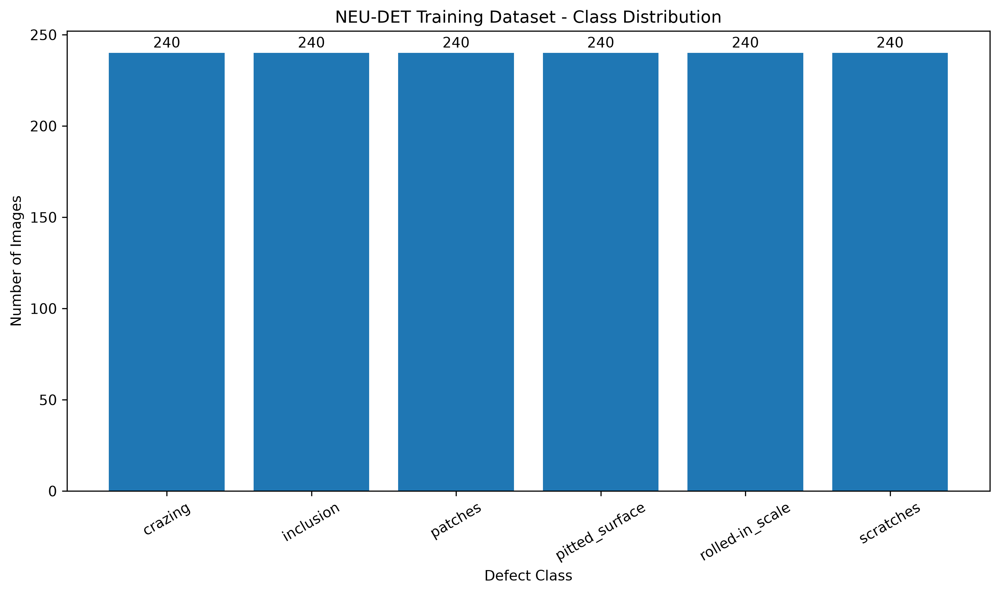 | 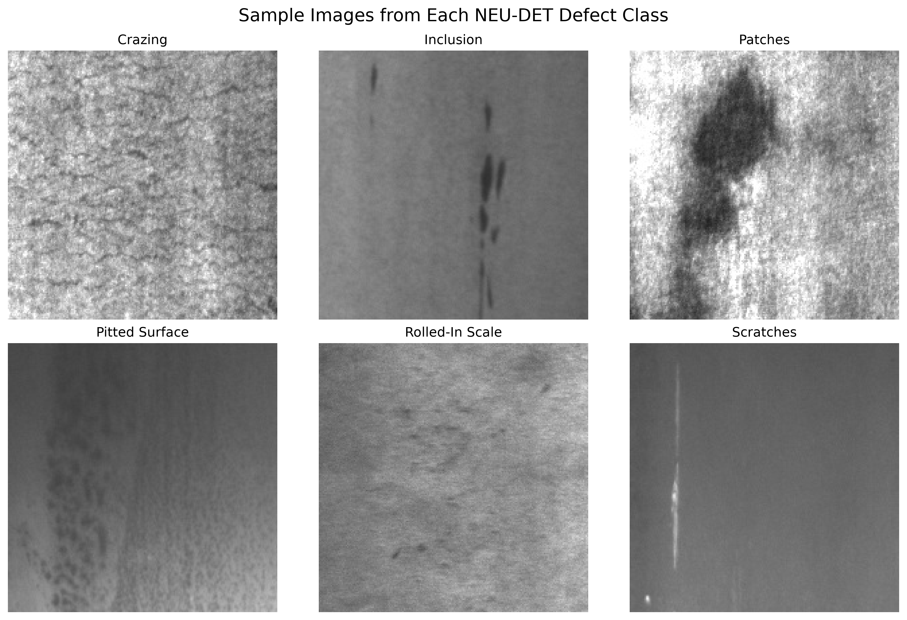 |
| *Figure 1: Uniform class distribution across all 6 defect categories (300 images per class).* | *Figure 2: Representative samples of Crazing, Inclusion, Patches, Pitted Surface, Rolled-in Scale, Scratches.* |

#### Multi-Defect Ground Truth Bounding Box Annotations
| Overview of Bounding Boxes | Detailed Multi-Defect Annotation (Example 1) |
| :---: | :---: |
| 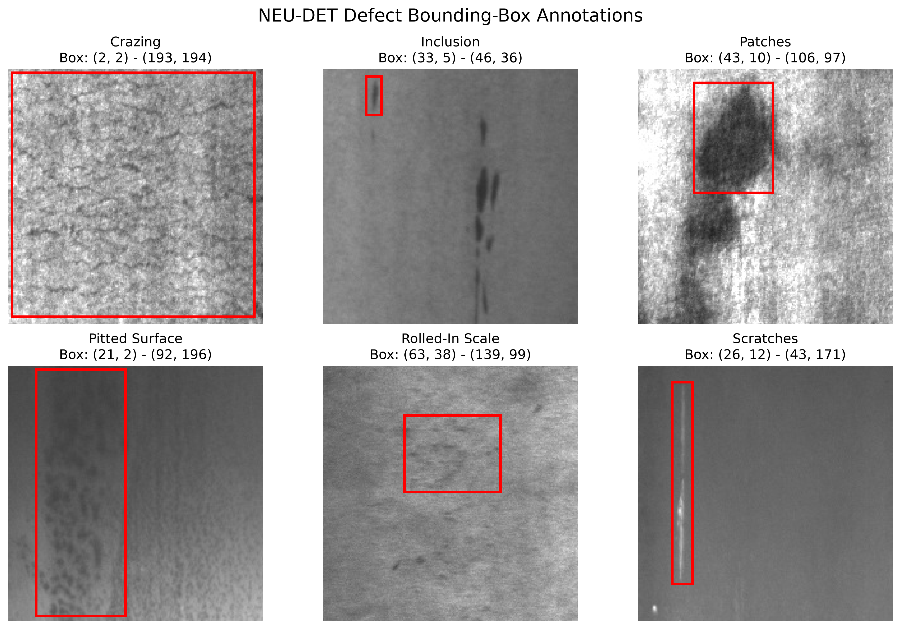 | 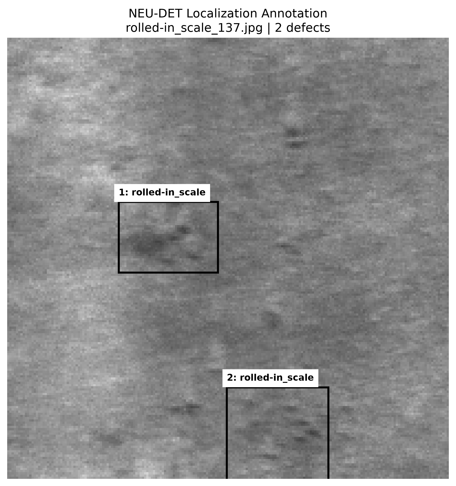 |
| *Figure 3: Multi-box annotation overlay on complex surface images.* | *Figure 4: Ground-truth bounding box coordinates and dimensions on sample image.* |

| Detailed Annotation (Example 2) | Detailed Annotation (Example 3) |
| :---: | :---: |
| 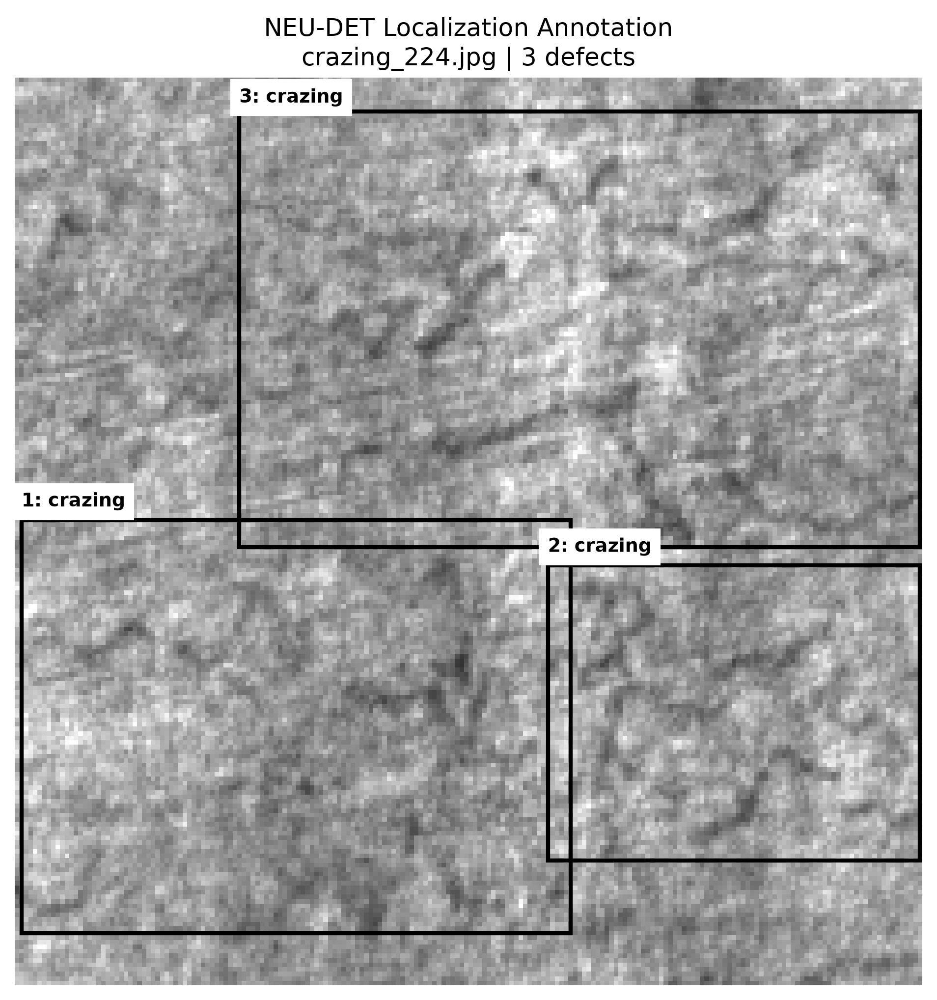 | 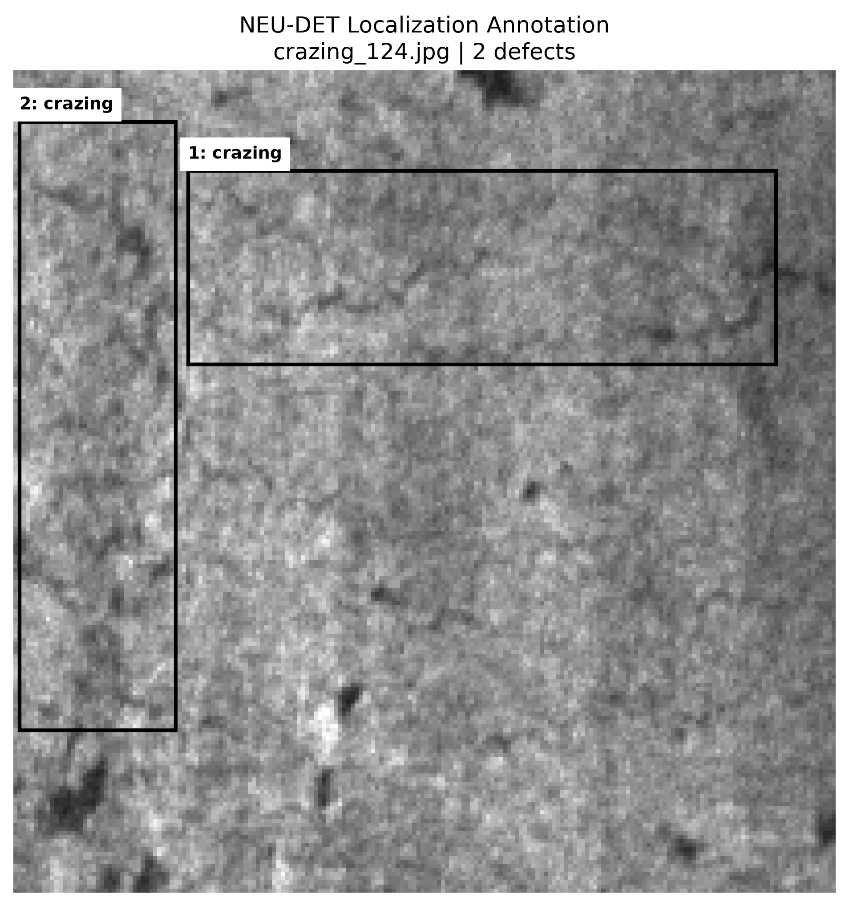 |
| *Figure 5: High-density multi-object ground truth bounding boxes.* | *Figure 6: Elongated defect bounding box localization on scratch/inclusion samples.* |

#### YOLO Format Coordinate Verification
| YOLO Verification 1 | YOLO Verification 2 | YOLO Verification 3 |
| :---: | :---: | :---: |
| 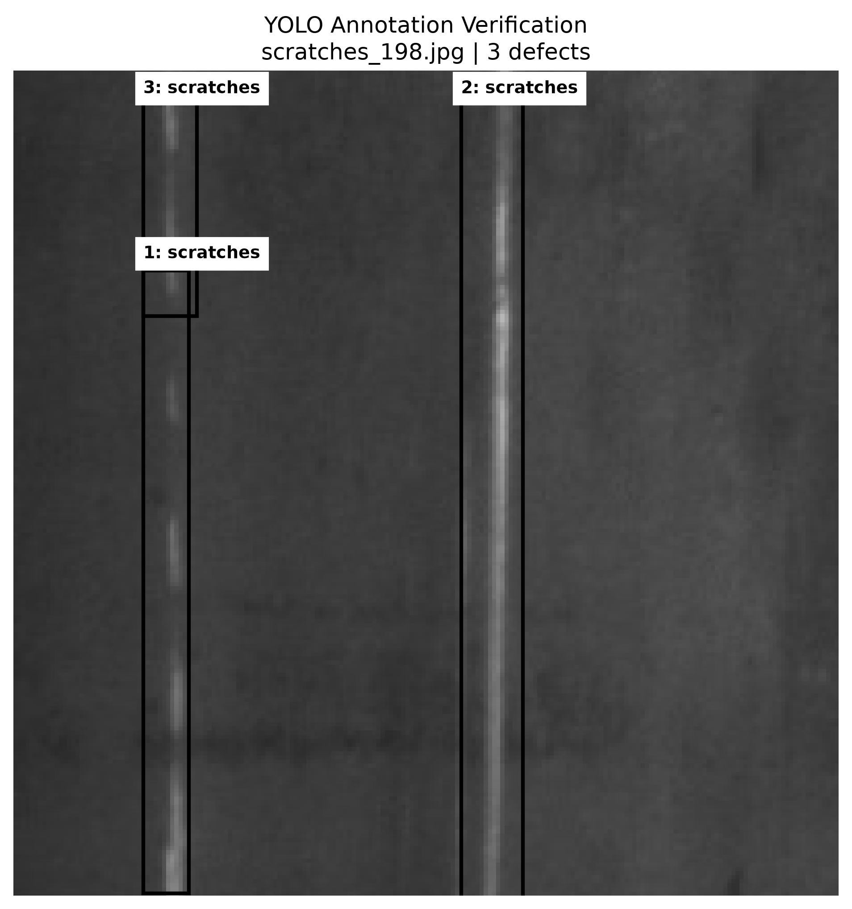 | 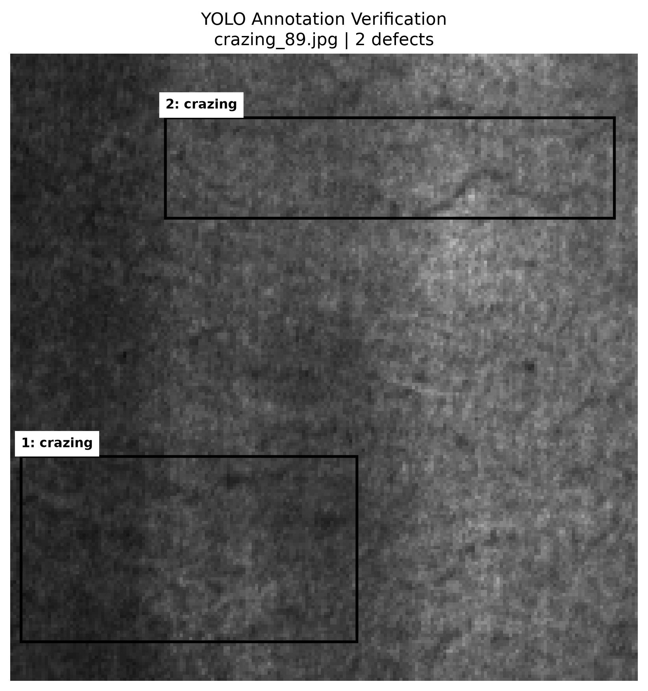 | 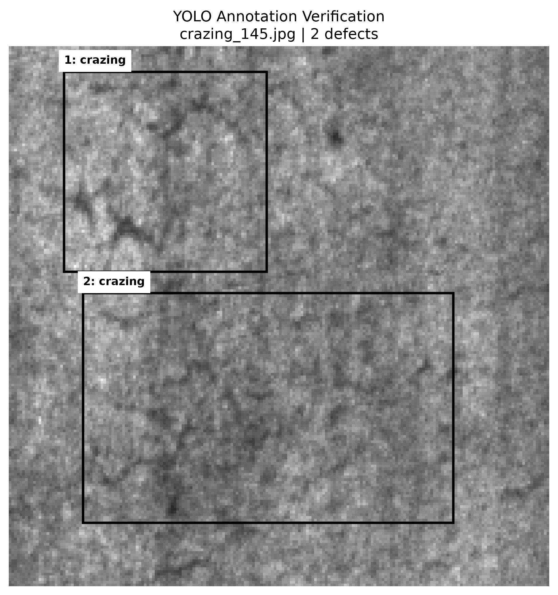 |
| *Figure 7: YOLO-normalized coordinates verified against image 1.* | *Figure 8: YOLO-normalized coordinates verified against image 2.* | *Figure 9: YOLO-normalized coordinates verified against image 3.* |

---

## 5. Machine Learning Methodology

### 5.1 Defect Classification Backbone: MobileNetV2

MobileNetV2 was selected as the primary classification backbone due to its lightweight parameter footprint, inverted residual blocks, and linear bottleneck layers.

- **Pretrained Weights**: ImageNet initialization (`include_top=False`).
- **Feature Extraction**: Base model backbone frozen (`base_model.trainable = False`) to preserve rich low-level spatial and texture filters.
- **Data Augmentation**: Integrated inline via Keras layers:
  - `RandomFlip("horizontal")`
  - `RandomRotation(0.05)` (up to $\pm 18^\circ$)
  - `RandomZoom(0.10)` (up to $10\%$)
- **Classification Head**:
  - `GlobalAveragePooling2D()` (pools $7 \times 7 \times 1280$ feature maps to 1280-dim feature vector)
  - `Dropout(0.20)` (regularization against overfitting)
  - `Dense(6, activation="softmax")` (generates categorical defect probabilities)
- **Training Hyperparameters**:
  - Optimizer: `Adam(learning_rate=0.0001)`
  - Loss Function: `categorical_crossentropy`
  - Batch Size: 16
  - Max Epochs: 15
  - Callbacks: `EarlyStopping(patience=4, restore_best_weights=True)` and `ModelCheckpoint(save_best_only=True)`
- **Parameter Breakdown**:
  - Total Parameters: **2,265,542** (~9.7 MB file size)
  - Trainable Head Parameters: **7,686**
  - Frozen Backbone Parameters: **2,257,856**

### 5.2 Comparative Classification Baseline: ResNet50

To benchmark MobileNetV2 against an established deep residual architecture, ResNet50 was implemented in `src/train_resnet50.py`:
- 50-layer deep residual network utilizing shortcut identity mappings to prevent gradient degradation.
- Preprocessing: `tf.keras.applications.resnet50.preprocess_input`.
- Architecture: ImageNet frozen backbone $\rightarrow$ `GlobalAveragePooling2D()` $\rightarrow$ `Dropout(0.2)` $\rightarrow$ `Dense(6, activation="softmax")`.
- Parameters: **23,600,006** parameters (~95.2 MB file size).

### 5.3 Object Localization Engine: YOLO11n

For bounding-box localization, the modern **YOLO11n (nano)** architecture from Ultralytics was trained (`src/train_yolo11n.py`):
- **Model Architecture**: Ultralytics YOLO11n featuring enhanced C3k2 modules, SPPF (Spatial Pyramid Pooling - Fast), and anchor-free decoupled detection head.
- **Pretrained Weights**: `yolo11n.pt` initialized from COCO.
- **Training Configuration** (verified from `results/model_results/yolo11n_baseline/args.yaml`):
  - Epochs: 20
  - Batch Size: 8
  - Image Size: 224
  - Optimizer: SGD auto-configured (`lr0=0.01`, `momentum=0.937`, `weight_decay=0.0005`)
  - Loss Coefficients: Box Loss = 7.5, Cls Loss = 0.5, DFL Loss = 1.5
  - Augmentations: Mosaic = 1.0, Horizontal Flip = 0.5, HSV jitter (`h=0.015, s=0.7, v=0.4`)

### 5.4 Explainable AI (XAI): Grad-CAM Implementation

Gradient-Weighted Class Activation Mapping (`src/generate_gradcam.py`) provides visual transparency into MobileNetV2's predictions:
1. **Target Layer Identification**: The last convolutional layer of MobileNetV2 (`Conv_1`, outputting $7 \times 7 \times 1280$ activation maps) captures high-level visual features before global pooling.
2. **Gradient Backpropagation**: For predicted class $c$, the gradient of score $y^c$ with respect to activation map $A_{i,j}^k$ is captured via `tf.GradientTape()`:
   $$\alpha_k^c = \frac{1}{Z} \sum_{i} \sum_{j} \frac{\partial y^c}{\partial A_{i,j}^k}$$
3. **Rectified Linear Combination**:
   $$L_{\text{Grad-CAM}}^c = \text{ReLU}\left(\sum_k \alpha_k^c A^k\right)$$
4. **Jet Colormap Overlay**: The normalized heatmap is interpolated to $224 \times 224$, transformed via OpenCV JET false-color mapping, and blended over the grayscale steel surface image.

### 5.5 Architecture Rationale: Why a Tri-Component System?

A central finding of this research is that **single-stage bounding-box detectors are fundamentally limited when applied to micro-texture surface phenomena**. Specifically:
- **Compact Object Defect Types** (e.g., *Inclusions* and *Patches*) exhibit clear boundaries and are effectively detected by YOLO bounding boxes.
- **Diffuse Multi-Crack Networks** (*Crazing*) cover large fractions of the image ($24.72\%$ average surface coverage) with low local contrast. As demonstrated in Section 7, YOLO fails to detect bounding boxes on $52$ validation images, with **$113$ missed ground-truth crazing boxes**.
- **The Synergy**: MobileNetV2 achieves **$100\%$ precision and recall** on Crazing classification. Grad-CAM visualizes the diffuse crack regions across the entire strip, successfully compensating for YOLO's bounding-box omissions without sacrificing localization precision on other defect categories.

---

## 6. Experimental Results & Quantitative Evaluation

All metrics reported below are exact, verifiable values taken directly from saved evaluation files in `results/model_results/`.

### 6.1 Classification Models Comparison

Evaluated on the independent 360-image validation dataset (60 images per class):

| Metric / Attribute | MobileNetV2 (Selected Production Model) | ResNet50 (Baseline Benchmark) |
| :--- | :---: | :---: |
| **Top-1 Accuracy** | **98.61%** (355 / 360 correct) | **96.94%** (349 / 360 correct) |
| **Validation Loss** | **0.1312** | **0.1048** |
| **Macro Precision** | **98.66%** | **97.11%** |
| **Macro Recall** | **98.61%** | **96.94%** |
| **Macro F1-Score** | **98.61%** | **96.89%** |
| **Training Time (15 Epochs, CPU)** | **20.97 minutes** (1,258.2 s) | **65.11 minutes** (3,906.4 s) |
| **Total Parameters** | **2,265,542** | **23,600,006** |
| **Serialized Model File Size** | **9.73 MB** (`mobilenetv2_baseline.keras`) | **95.18 MB** (`resnet50_baseline.keras`) |

> **Conclusion**: MobileNetV2 achieved higher classification accuracy ($+1.67\%$), faster training and inference ($3.1\times$ speedup), and a $10\times$ smaller memory footprint, making it the superior choice for production edge deployment.

### 6.2 MobileNetV2 Detailed Evaluation & Confusion Matrix

From `results/model_results/mobilenetv2_classification_report.csv`:

| Defect Class | Precision | Recall | F1-Score | Support (Validation Images) |
| :--- | :---: | :---: | :---: | :---: |
| **Crazing** | **1.0000** | **1.0000** | **1.0000** | 60 |
| **Inclusion** | **1.0000** | 0.9500 | 0.9744 | 60 |
| **Patches** | **1.0000** | 0.9833 | 0.9916 | 60 |
| **Pitted Surface** | 0.9516 | 0.9833 | 0.9672 | 60 |
| **Rolled-in Scale** | 0.9677 | **1.0000** | 0.9836 | 60 |
| **Scratches** | **1.0000** | **1.0000** | **1.0000** | 60 |
| **Accuracy** | — | — | **0.9861** | 360 |
| **Macro Average** | **0.9866** | **0.9861** | **0.9861** | 360 |
| **Weighted Average** | **0.9866** | **0.9861** | **0.9861** | 360 |

#### MobileNetV2 Performance Visualizations
| Training & Validation Accuracy | Training & Validation Loss | Normalized Confusion Matrix |
| :---: | :---: | :---: |
| 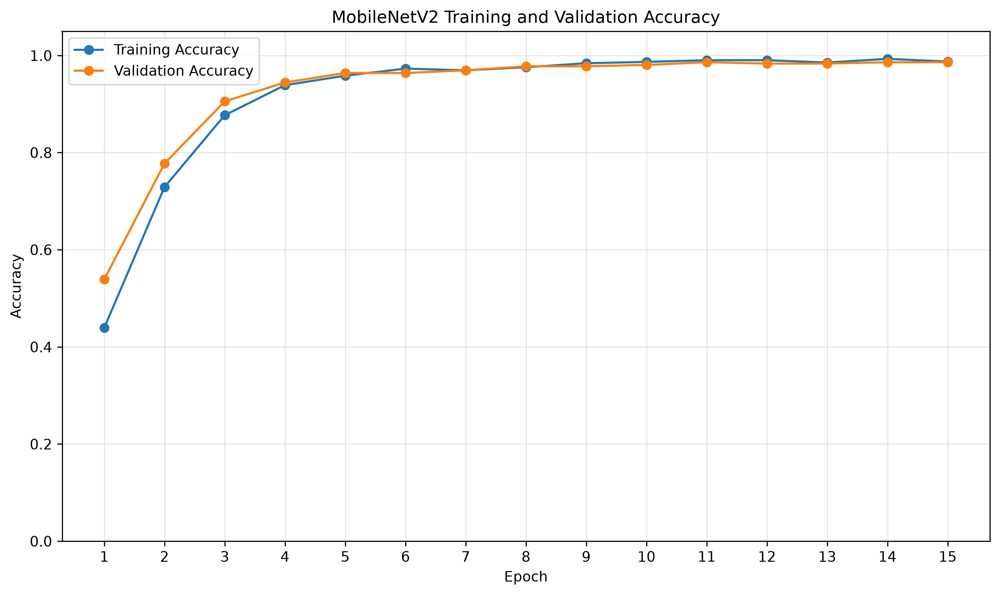 | 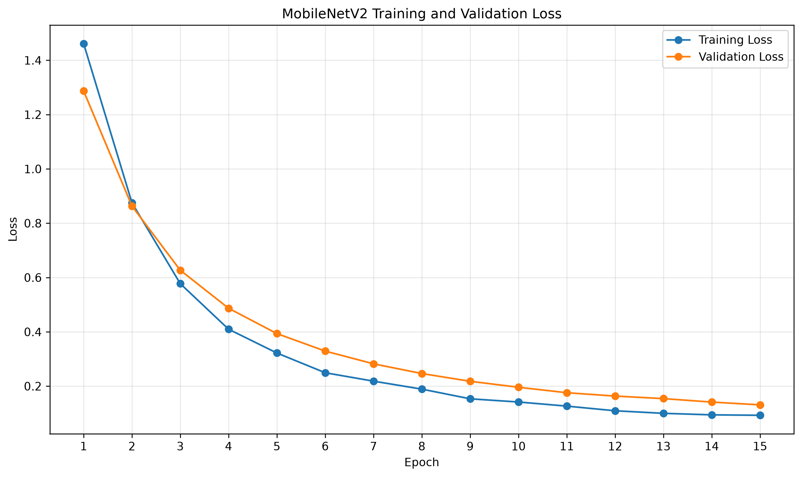 | 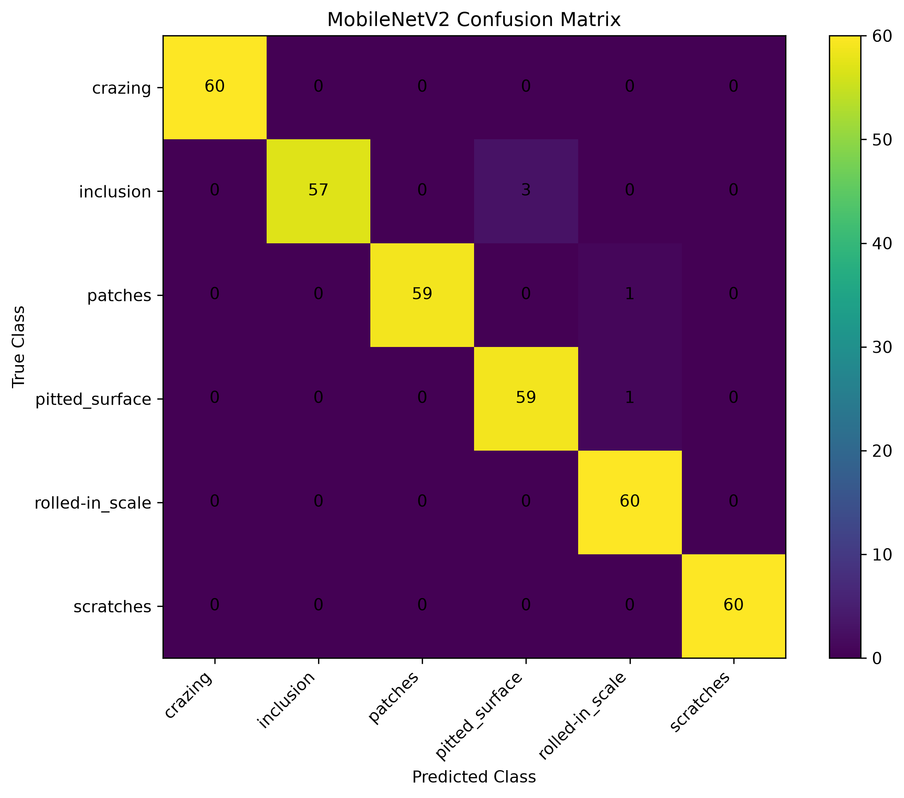 |
| *Figure 10: Smooth accuracy convergence reaching 98.61% validation accuracy.* | *Figure 11: Categorical cross-entropy loss decreasing monotonically to 0.1312.* | *Figure 12: Near-diagonal confusion matrix with only 5 misclassifications out of 360 images.* |

### 6.3 ResNet50 Detailed Evaluation & Confusion Matrix

From `results/model_results/resnet50_classification_report.csv`:

| Defect Class | Precision | Recall | F1-Score | Support (Validation Images) |
| :--- | :---: | :---: | :---: | :---: |
| **Crazing** | **1.0000** | **1.0000** | **1.0000** | 60 |
| **Inclusion** | **1.0000** | 0.8500 | 0.9189 | 60 |
| **Patches** | **1.0000** | **1.0000** | **1.0000** | 60 |
| **Pitted Surface** | 0.9231 | **1.0000** | 0.9600 | 60 |
| **Rolled-in Scale** | 0.9677 | **1.0000** | 0.9836 | 60 |
| **Scratches** | 0.9355 | 0.9667 | 0.9508 | 60 |
| **Accuracy** | — | — | **0.9694** | 360 |
| **Macro Average** | **0.9711** | **0.9694** | **0.9689** | 360 |
| **Weighted Average** | **0.9711** | **0.9694** | **0.9689** | 360 |

#### ResNet50 Performance Visualizations
| Training & Validation Accuracy | Training & Validation Loss | Confusion Matrix |
| :---: | :---: | :---: |
| 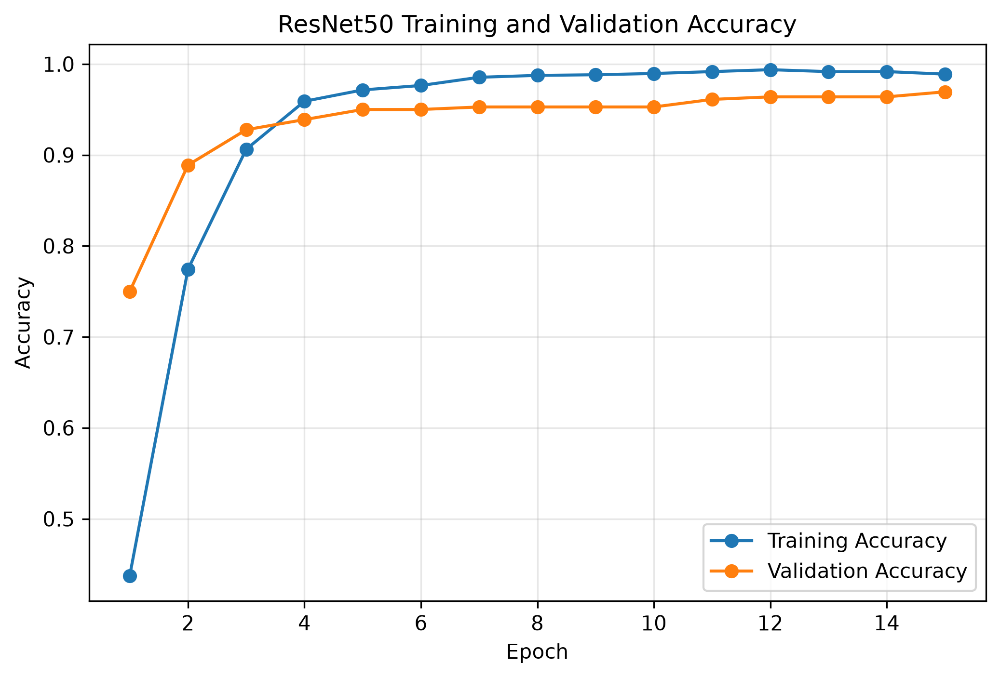 | 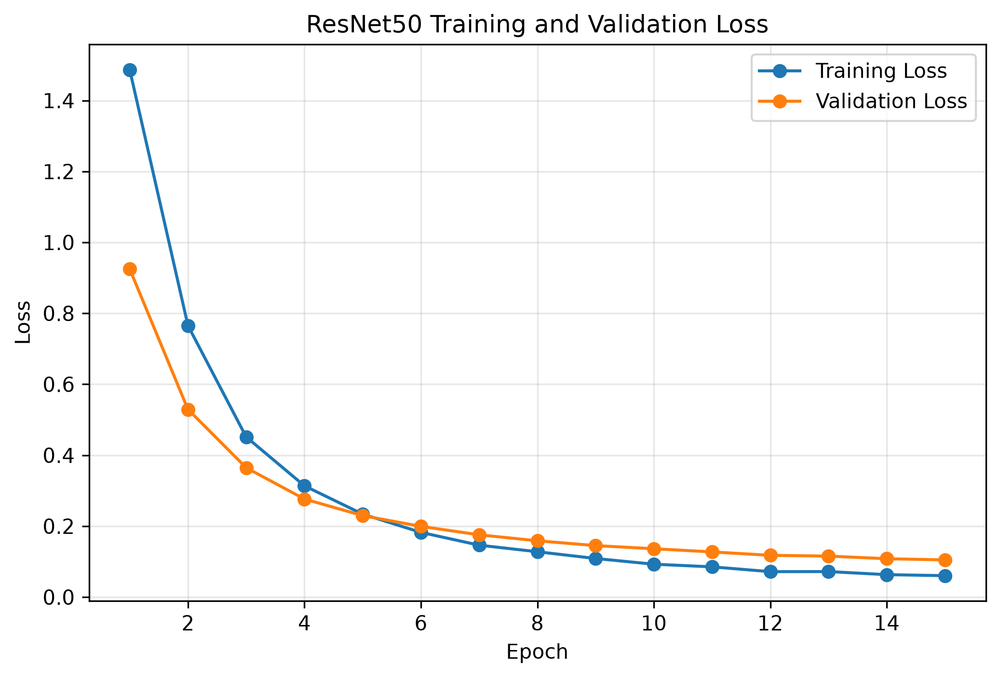 | 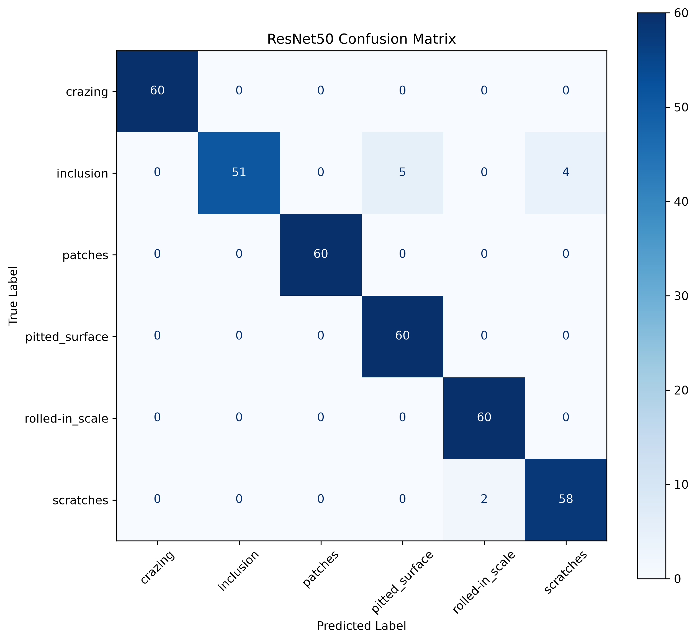 |
| *Figure 13: ResNet50 validation accuracy progression peaking at 96.94%.* | *Figure 14: ResNet50 validation loss decreasing to 0.1048.* | *Figure 15: Confusion matrix showing 9 false negatives on subtle Inclusion samples.* |

### 6.4 YOLO11n Object Localization Performance

Trained for 20 epochs on CPU (`results/model_results/yolo11n_baseline/results.csv`):

| Epoch | Train Box Loss | Train Cls Loss | Precision (B) | Recall (B) | mAP@0.50 (B) | mAP@0.50:0.95 (B) | Val Box Loss | Val Cls Loss |
| :---: | :---: | :---: | :---: | :---: | :---: | :---: | :---: | :---: |
| **1** | 1.8953 | 3.5136 | 56.09% | 26.73% | 24.49% | 9.02% | 2.2100 | 3.1196 |
| **5** | 1.6907 | 1.7546 | 52.74% | 56.95% | 49.27% | 22.21% | 1.8293 | 2.5383 |
| **10** | 1.5314 | 1.5166 | 71.72% | 50.55% | 57.32% | 26.75% | 1.7543 | 1.9160 |
| **15** | 1.4454 | 1.4508 | 65.56% | 58.27% | 64.83% | 33.08% | 1.5639 | 1.6070 |
| **20** | **1.3548** | **1.3261** | **70.50%** | **61.38%** | **69.71%** | **37.25%** | **1.5368** | **1.5005** |

#### YOLO11n Training Metrics & Precision-Recall Curves
| Comprehensive Metric Curves | Normalized Confusion Matrix |
| :---: | :---: |
| 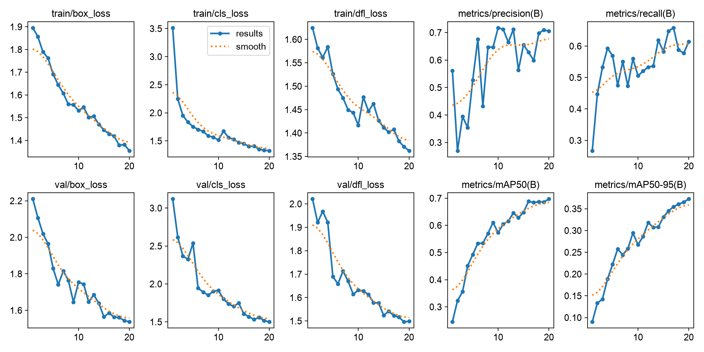 | 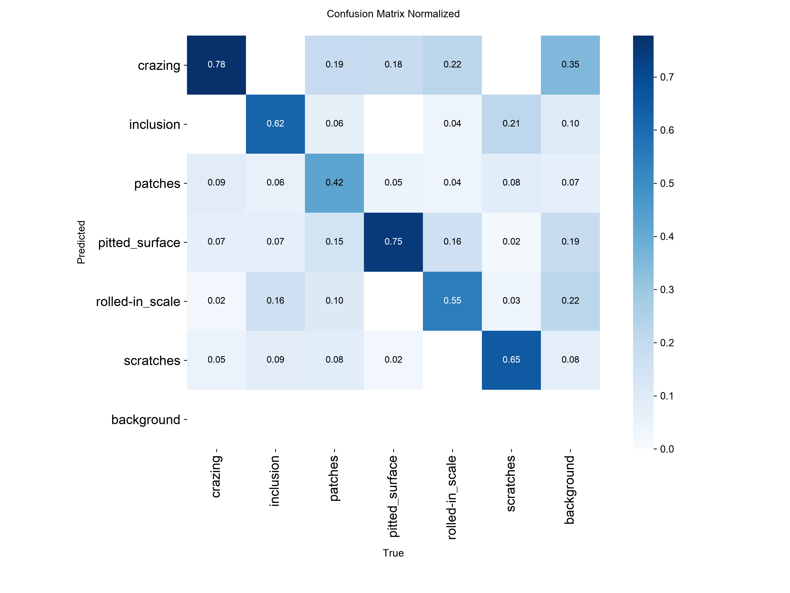 |
| *Figure 16: Epoch-by-epoch loss reduction, Precision, Recall, and mAP curves.* | *Figure 17: Normalized detection matrix showing high accuracy on Patches, Inclusions, and Scratches.* |

| Precision-Recall Curve (mAP@0.5) | F1-Confidence Curve |
| :---: | :---: |
| 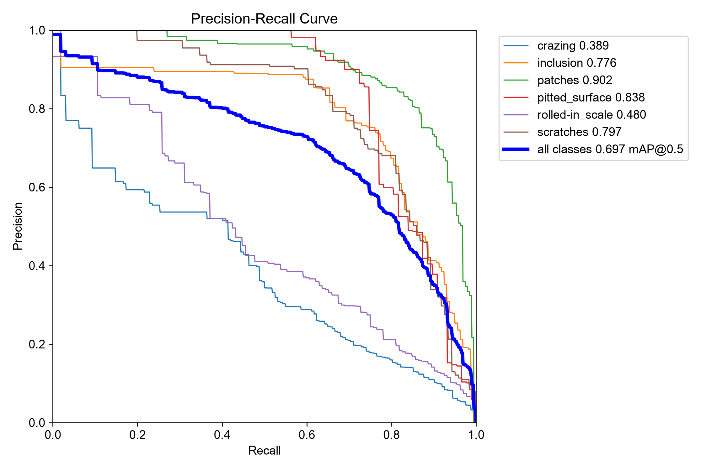 | 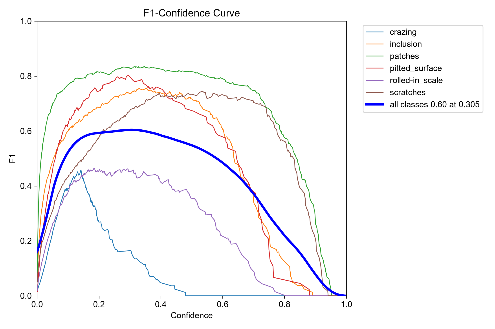 |
| *Figure 18: Precision-Recall curves across all six classes showing optimal trade-offs.* | *Figure 19: F1-score as a function of confidence threshold.* |

#### Validation Batch Predictions vs. Ground Truth
| Validation Batch 0 Ground Truth Labels | Validation Batch 0 Model Predictions |
| :---: | :---: |
| 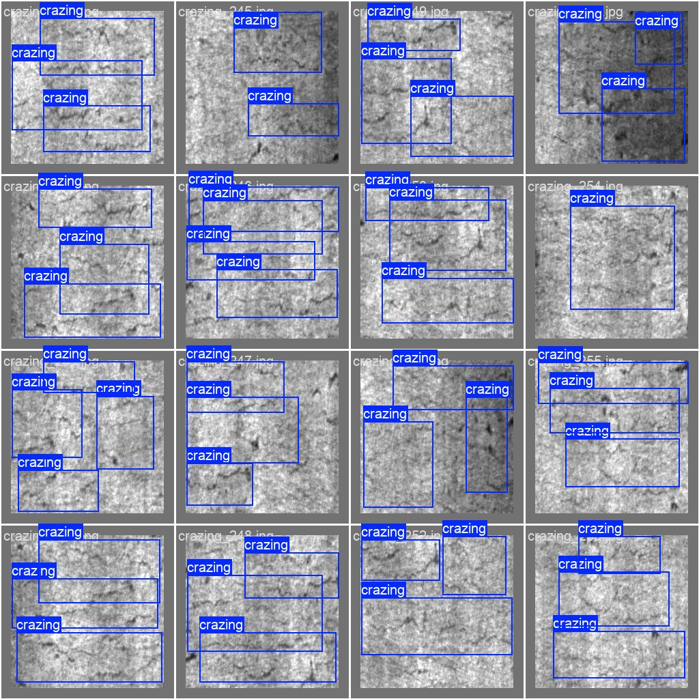 | 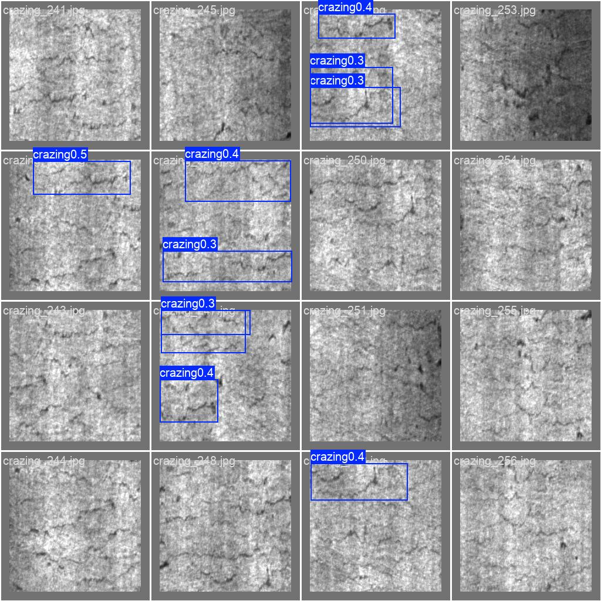 |
| *Figure 20: Ground truth bounding boxes for validation batch 0.* | *Figure 21: YOLO11n predicted bounding boxes matching ground truth labels.* |

---

## 7. In-Depth Error Analysis: The Crazing Defect Challenge

### 7.1 Empirical Analysis of Zero-Prediction Cases

A systematic evaluation of YOLO11n predictions across the entire 360-image validation set (`src/analyze_yolo_errors.py`, documented in `results/model_results/yolo11n_baseline/yolo11n_error_analysis.json`) revealed a significant challenge with specific defect types:
- **Validation Images with Predictions**: 308 images ($85.56\%$)
- **Validation Images with Zero Predictions**: **52 images ($14.44\%$)**
- **Ground Truth Boxes Missed in Zero-Prediction Images**:
  - **Crazing**: **113 missed boxes** ($88.28\%$ of all missed boxes)
  - **Rolled-in Scale**: **15 missed boxes** ($11.72\%$ of all missed boxes)
  - *All other classes (Inclusion, Patches, Pitted Surface, Scratches)*: **0 zero-prediction images**.

### 7.2 Ground Truth vs. Prediction Discrepancy

| Defect Class | Ground Truth Boxes | YOLO Predicted Boxes | Detection Ratio (%) | Mean Detection Confidence |
| :--- | :---: | :---: | :---: | :---: |
| **Crazing** | **162** | **19** | **11.73% (Severe Under-detection)** | **0.3202** (min 0.2519, max 0.4956) |
| **Inclusion** | 159 | 172 | 108.18% | 0.5452 (min 0.2531, max 0.8932) |
| **Patches** | 193 | 188 | 97.41% | **0.6967** (min 0.2502, max 0.9744) |
| **Pitted Surface** | 87 | 68 | 78.16% | 0.6490 (min 0.2656, max 0.8998) |
| **Rolled-in Scale** | 132 | 90 | 68.18% | 0.4430 (min 0.2577, max 0.7373) |
| **Scratches** | 121 | 132 | 109.09% | 0.6582 (min 0.2523, max 0.9454) |

### 7.3 Visual Failure Cases

Side-by-side comparisons generated by `src/visualize_yolo_failure_cases.py` contrasting ground-truth bounding boxes (blue) with YOLO11n predictions (showing zero predicted boxes):

| Failure Case 1: Zero Predictions on Crazing | Failure Case 2: Zero Predictions on Crazing |
| :---: | :---: |
| 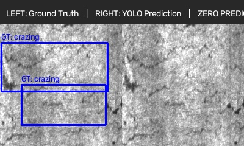 | 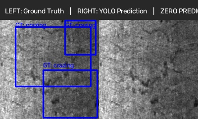 |
| *Figure 22: Ground truth crazing network completely undetected by YOLO bounding boxes.* | *Figure 23: Dispersed micro-crack patterns where anchor-free YOLO outputs no detections.* |

| Failure Case 3: Zero Predictions on Crazing | Failure Case 4: Zero Predictions on Crazing |
| :---: | :---: |
| 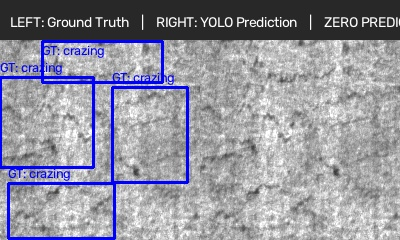 | 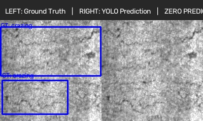 |
| *Figure 24: Complex distributed crazing defect with 0 detections above default threshold.* | *Figure 25: Thermal crack network missed due to diffuse boundary characteristics.* |

### 7.4 Complementary Role of Grad-CAM in Resolving Failures

Why does YOLO struggle with Crazing while MobileNetV2 succeeds?
1. **Nature of Crazing**: Crazing consists of a spiderweb-like mesh of microscopic cracks spreading over large regions without defined edges or solid interiors. Standard bounding box regressors expect compact object centroids.
2. **Confidence Threshold Sensitivity**: YOLO's confidence on crazing averages only $0.3202$. Lowering the threshold to `conf=0.10` recovers some detections, but many remain unlocalized.
3. **The Grad-CAM Resolution**: MobileNetV2 analyzes global spatial representations and achieves **$100\%$ accuracy** on crazing. Grad-CAM backpropagates gradients through `Conv_1` to highlight the exact micro-crack mesh across the entire image (see Section 9), providing the necessary localization evidence even when bounding-box object detectors find zero discrete instances.

---

## 8. Application Features & User Guide

### 8.1 Interactive Streamlit Application (`app.py`)

The project features a full-featured visual inspection dashboard developed in Streamlit:
- **Interactive File Uploader**: Drag-and-drop or browse for `.jpg`, `.jpeg`, and `.png` steel surface images.
- **Synchronized Tri-Component Execution**: Clicking **"🔍 Analyze Image"** runs MobileNetV2, YOLO11n, and Grad-CAM in a single pass.
- **Dual High-Level Metric Cards**: Instant display of Predicted Defect Class and Classification Confidence percentage.
- **Full Class Probability Bar Chart**: Dynamic distribution chart breaking down likelihoods across all 6 defect types.
- **Localized Defect Region Counter & Coordinate List**: Bounding box count, per-box confidence, and coordinate readouts.
- **Visual Saliency Explanation Overlay**: Immediate Grad-CAM visualization explaining what features triggered the classifier.
- **Metallurgical Scope & Disclaimer**: Plain-text operational statement clarifying system boundaries.
- **One-Click JSON Audit Report Download**: Generates and downloads a complete `steel_surface_inspection_report.json`.

### 8.2 Inspection Workflow Demonstration

The integrated pipeline outputs from `results/figures/final_inspection/` illustrate the system's combined output on a test sample (`crazing_241.jpg`):

| YOLO11n Defect Localization Overlay | Grad-CAM Classification Explanation Overlay |
| :---: | :---: |
| 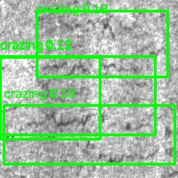 | 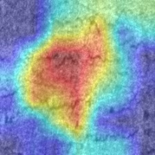 |
| *Figure 26: YOLO11n localization identifying visible defect regions with bounding box overlays.* | *Figure 27: Grad-CAM heatmap highlighting activation regions corresponding to micro-cracks.* |

### 8.3 Automated JSON Inspection Report Export

Every inspection run produces an exportable JSON report (`steel_surface_inspection_report.json`):

```json
{
    "input_image": "crazing_241.jpg",
    "classification": {
        "predicted_class": "crazing",
        "confidence": 0.5209,
        "all_class_probabilities": {
            "crazing": 0.5209,
            "inclusion": 0.0310,
            "patches": 0.0086,
            "pitted_surface": 0.3805,
            "rolled-in_scale": 0.0530,
            "scratches": 0.0060
        }
    },
    "localization": {
        "number_of_detections": 4,
        "detections": [
            {
                "class": "crazing",
                "class_id": 0,
                "confidence": 0.1773,
                "box": [41, 12, 188, 86]
            },
            {
                "class": "crazing",
                "class_id": 0,
                "confidence": 0.1757,
                "box": [4, 118, 196, 184]
            }
        ]
    },
    "explainability": {
        "method": "Grad-CAM",
        "target_class": "crazing",
        "description": "Visualization of image regions contributing to the classification prediction."
    },
    "scope": {
        "system_type": "AI-assisted visual inspection",
        "limitations": "The system performs visible defect classification and localization. It does not determine structural strength, material safety, or suitability for reuse."
    }
}
```

### 8.4 Sample Defect Localizations

The model's localization performance across diverse defect categories (`results/figures/final_yolo_examples/` and `results/figures/yolo_predictions/`):

| Crazing Detection Example | Inclusion Detection Example | Patches Detection Example |
| :---: | :---: | :---: |
| 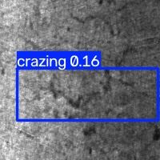 | 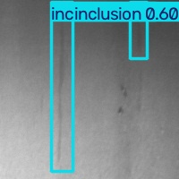 | 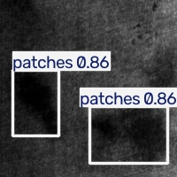 |
| *Figure 28: Low-threshold localization on crazing cracks.* | *Figure 29: Tight bounding box pin-pointing surface inclusion.* | *Figure 30: Robust bounding box detection of irregular patches.* |

| Rolled-in Scale Detection Example | Scratches Detection Example | Prediction Sample: Inclusion (0.89) |
| :---: | :---: | :---: |
| 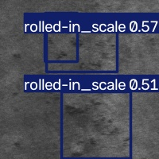 | 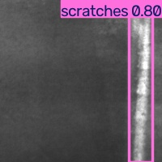 |  |
| *Figure 31: Detection of embedded oxidation scale.* | *Figure 32: Longitudinal scratch line localization.* | *Figure 33: High-confidence prediction on inclusion defect.* |

---

## 9. Explainability Showcase (Grad-CAM)

The repository includes Grad-CAM saliency heatmaps generated across all six defect classes (`results/figures/gradcam/`). Warm colors (red, orange, yellow) indicate regions that strongly drove MobileNetV2's classification decision, while cool colors (blue, cyan) indicate neutral background steel:

| Crazing (crazing_241.jpg) | Crazing (crazing_289.jpg) | Inclusion (inclusion_241.jpg) |
| :---: | :---: | :---: |
|  | 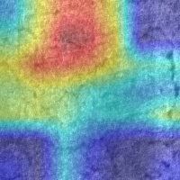 | 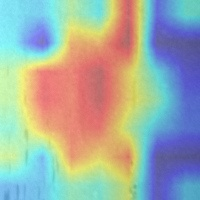 |
| *Figure 34: Heatmap activating along micro-crack network lines.* | *Figure 35: Saliency map focusing on distributed crazing fissures.* | *Figure 36: Saliency map centered on non-metallic impurity cluster.* |

| Patches (patches_241.jpg) | Pitted Surface (pitted_surface_241.jpg) | Rolled-in Scale (rolled-in_scale_241.jpg) | Scratches (scratches_241.jpg) |
| :---: | :---: | :---: | :---: |
| 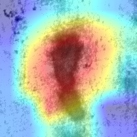 | 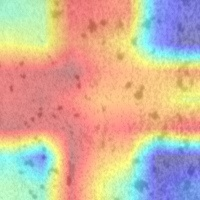 | 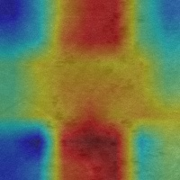 | 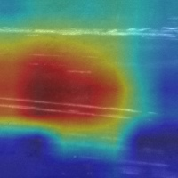 |
| *Figure 37: Heatmap focused on irregular patch boundaries.* | *Figure 38: Broad heatmap reflecting widespread surface pitting.* | *Figure 39: Heatmap tracking compressed rolling scale.* | *Figure 40: Linear heatmap tracing sharp abrasive scratch paths.* |

---

## 10. Project Directory Structure

A clean, annotated representation of the actual repository layout:

```text
NEU_FYP/
├── app.py                                  # Interactive Streamlit web application dashboard
├── yolo11n.pt                              # Base pretrained YOLO11n model weights (Ultralytics)
│
├── src/                                    # Source code: training, evaluation, XAI & pipeline scripts
│   ├── final_inspection_pipeline.py        # Core unified inference engine (MobileNetV2 + YOLO11n + Grad-CAM)
│   ├── Dataset_Inspection.py               # Checks dataset integrity, image sizes, and Pascal VOC XML structure
│   ├── data_preparation.py                 # Validates image readability and compiles class indexes
│   ├── data_visualization.py               # Generates class distribution and sample dataset figures
│   ├── prepare_detection_dataset.py        # Compiles Pascal VOC annotations into unified JSON summaries
│   ├── check_annotations.py                # Audits bounding box coordinates against image dimensions
│   ├── convert_to_yolo_format.py           # Converts Pascal VOC pixel bounding boxes to normalized YOLO format
│   ├── build_yolo_dataset.py               # Assembles directory layout for Ultralytics YOLO training
│   ├── verify_yolo_annotations.py          # Verifies bounding box conversions and class mapping
│   ├── verify_yolo_dataset.py              # Generates visual verification plots of YOLO bounding boxes
│   ├── visualize_localization_annotations.py # Visualizes multi-defect bounding boxes on steel images
│   ├── analyze_localization_annotations.py # Analyzes box counts, overlaps, and multi-defect frequencies
│   ├── analyze_detection_box_statistics.py # Calculates bounding box widths, heights, areas, and surface coverage
│   ├── train_mobilenetv2.py                # Fine-tunes MobileNetV2 transfer learning model with callbacks
│   ├── evaluate_mobilenetv2.py             # Evaluates MobileNetV2; generates metrics CSV and confusion matrix
│   ├── plot_mobilenetv2_history.py         # Plots accuracy and loss curves from training history JSON
│   ├── train_resnet50.py                   # Trains baseline ResNet50 classifier for comparative evaluation
│   ├── evaluate_resnet50.py                # Evaluates ResNet50; generates metrics CSV and confusion matrix
│   ├── plot_resnet50_history.py            # Plots ResNet50 training and validation loss/accuracy curves
│   ├── train_yolo11n.py                    # Trains YOLO11n nano detector for defect bounding-box localization
│   ├── analyze_yolo_errors.py              # Evaluates YOLO on validation set; compiles error statistics
│   ├── test_yolo_low_confidence.py         # Tests sensitivity of YOLO under lowered confidence thresholds
│   ├── visualize_yolo_failure_cases.py     # Generates side-by-side failure case figures for missed crazing
│   ├── visualize_yolo_predictions.py       # Renders sample predicted bounding boxes on validation images
│   ├── generate_final_yolo_examples.py     # Exports selected YOLO detection examples across defect types
│   ├── generate_gradcam.py                 # Core Grad-CAM algorithm backpropagating gradients from Conv_1
│   └── test_gradcam_crazing289.py          # Validates Grad-CAM execution on difficult crazing sample 289
│
├── results/                                # Output artifacts: models, metrics, figures, and data
│   ├── dataset_analysis/
│   │   └── detection_box_statistics.json   # Statistical breakdown of bounding boxes, sizes, and coverage
│   │
│   ├── detection_dataset/                  # Converted dataset annotations and YOLO directory structure
│   │   ├── class_mapping.json              # Integer-to-class-name mapping dictionary
│   │   ├── detection_dataset_summary.json  # Image and box counts per split and per class
│   │   ├── train_annotations.json          # Parsed Pascal VOC train set annotations in JSON format
│   │   ├── validation_annotations.json     # Parsed Pascal VOC validation set annotations in JSON format
│   │   ├── yolo_conversion_summary.json    # Summary of YOLO normalized bounding box conversion
│   │   ├── train/labels/                   # Normalized YOLO label text files (1,440 files)
│   │   ├── validation/labels/              # Normalized YOLO label text files (360 files)
│   │   └── yolo_dataset/                   # Production dataset used by YOLO11n
│   │       ├── neu_defects.yaml            # Ultralytics dataset configuration file
│   │       ├── images/ (train & val)       # Full steel surface image files (1,440 train, 360 val)
│   │       └── labels/ (train & val)       # Full YOLO coordinate text files (1,440 train, 360 val)
│   │
│   ├── model_results/                      # Saved trained models, history logs, and evaluation reports
│   │   ├── mobilenetv2_baseline.keras      # Trained MobileNetV2 model weights (9.73 MB, 98.61% accuracy)
│   │   ├── mobilenetv2_history.json        # Epoch-by-epoch loss, accuracy, and training time data
│   │   ├── mobilenetv2_classification_report.csv # Per-class precision, recall, and F1-score table
│   │   ├── mobilenetv2_accuracy_curve.png  # MobileNetV2 accuracy trajectory plot
│   │   ├── mobilenetv2_loss_curve.png      # MobileNetV2 categorical cross-entropy loss trajectory plot
│   │   ├── mobilenetv2_confusion_matrix.png # MobileNetV2 confusion matrix visualization
│   │   ├── resnet50_baseline.keras         # Trained ResNet50 baseline model weights (95.18 MB, 96.94% accuracy)
│   │   ├── resnet50_history.json           # ResNet50 epoch-by-epoch metrics and training time
│   │   ├── resnet50_classification_report.csv # ResNet50 per-class evaluation table
│   │   ├── resnet50_accuracy_curve.png     # ResNet50 accuracy trajectory plot
│   │   ├── resnet50_loss_curve.png         # ResNet50 loss trajectory plot
│   │   ├── resnet50_confusion_matrix.png   # ResNet50 confusion matrix visualization
│   │   └── yolo11n_baseline/               # Ultralytics YOLO11n training run directory
│   │       ├── weights/
│   │       │   ├── best.pt                 # Best checkpoint weights by mAP@0.50 (5.42 MB)
│   │       │   └── last.pt                 # Final checkpoint weights at epoch 20 (5.42 MB)
│   │       ├── args.yaml                   # Complete hyperparameters and training settings log
│   │       ├── results.csv                 # Per-epoch loss, precision, recall, and mAP progression
│   │       ├── results.png                 # Summary plot of all YOLO training and validation metrics
│   │       ├── confusion_matrix.png        # Raw detection confusion matrix
│   │       ├── confusion_matrix_normalized.png # Normalized detection confusion matrix
│   │       ├── BoxP_curve.png              # Precision-Confidence curve
│   │       ├── BoxR_curve.png              # Recall-Confidence curve
│   │       ├── BoxPR_curve.png             # Precision-Recall curve (mAP@0.50)
│   │       ├── BoxF1_curve.png             # F1-Confidence curve
│   │       ├── labels.jpg                  # Distribution and spatial scatter of bounding boxes
│   │       ├── val_batch*_labels.jpg       # Ground truth label visual samples
│   │       ├── val_batch*_pred.jpg         # Model prediction visual samples
│   │       └── yolo11n_error_analysis.json # Quantitative failure analysis across all 360 val images
│   │
│   └── figures/                            # Visual assets, figures, and pipeline outputs
│       ├── class_distribution.png          # Bar chart of dataset class frequencies
│       ├── sample_images.png               # Grid of sample defect images across all 6 classes
│       ├── bounding_boxes.png              # Multi-defect bounding box visualization
│       ├── localization_example_*.png      # Individual localization examples (1 through 6)
│       ├── yolo_verification_*.png         # YOLO format verification plots (1 through 6)
│       ├── final_yolo_examples/            # Representative detection examples for each defect type
│       ├── yolo_predictions/              # Validation predictions with confidence overlays (1 through 12)
│       ├── yolo_failure_cases/             # Crazing failure case comparisons (zero-prediction cases 1 to 6)
│       ├── gradcam/                        # Grad-CAM saliency overlays across all defect classes
│       └── final_inspection/               # Output artifacts from end-to-end inspection pipeline
│           ├── crazing_241_detection.jpg   # Detection output image for test sample
│           ├── crazing_241_gradcam.jpg     # Grad-CAM output image for test sample
│           └── crazing_241_result.json     # Comprehensive structured inspection result JSON
│
├── datasets/                               # Reserved directory for raw dataset archives
├── models/                                 # Reserved directory for auxiliary model checkpoints
└── notebooks/                              # Reserved directory for interactive Jupyter exploration
```

---

## 11. Installation & Environment Setup

### 11.1 Prerequisites

- **Operating System**: Windows 10/11, Ubuntu 20.04/22.04 LTS, or macOS (12+)
- **Python**: Version `3.10`, `3.11`, or `3.12` (Project developed and tested on Python `3.12.4`)
- **Git**: Installed and accessible in your system terminal
- **RAM**: Minimum 8 GB (16 GB recommended for model training)
- **Disk Space**: ~5 GB free space (for repository, models, and dataset images)
- **GPU (Optional)**: NVIDIA GPU with CUDA 11.8+ / 12.0+ support (CPU execution is fully supported)

### 11.2 Environment Configuration

Clone the repository and set up an isolated Python virtual environment:

```bash
# Clone the repository
git clone https://github.com/<your-username>/NEU_FYP.git
cd NEU_FYP

# Create a virtual environment named .venv
python -m venv .venv

# Activate the virtual environment:
# On Windows (Command Prompt):
.venv\Scripts\activate.bat

# On Windows (PowerShell):
.venv\Scripts\Activate.ps1

# On Linux or macOS:
source .venv/bin/activate
```

### 11.3 Dependency Installation

Install the required core packages using `pip`:

```bash
# Upgrade pip, setuptools, and wheel
python -m pip install --upgrade pip setuptools wheel

# Install core deep learning, vision, and application libraries
pip install tensorflow==2.21.0 keras==3.15.1
pip install torch torchvision --index-url https://download.pytorch.org/whl/cpu
pip install ultralytics==8.4.171
pip install streamlit==1.64.0 opencv-python pillow matplotlib scikit-learn pandas numpy pyyaml
```

*Note for GPU users*: To enable GPU acceleration with PyTorch and TensorFlow, install the CUDA-enabled builds according to your installed CUDA driver version.

### 11.4 Pretrained Weights & Dataset Setup

1. **Pretrained Weights**:
   - The trained MobileNetV2 model (`results/model_results/mobilenetv2_baseline.keras`), ResNet50 model (`results/model_results/resnet50_baseline.keras`), and YOLO11n weights (`results/model_results/yolo11n_baseline/weights/best.pt`) are already included in the repository.
   - The base YOLO11n weights (`yolo11n.pt`, 5.6 MB) are stored in the project root.
2. **Dataset**:
   - The converted dataset containing all 1,440 training images and 360 validation images, along with their YOLO `.txt` labels, is included in `results/detection_dataset/yolo_dataset/`.
   - To inspect or run training scripts referencing external raw datasets, download the official **NEU-DET** dataset from the [Northeastern University Surface Defect Database](http://faculty.neu.edu.cn/yunhyan/NEU_surface_defect_database.html) or [Kaggle NEU-DET](https://www.kaggle.com/datasets/kaustubhdikshit/neu-surface-defect-database) and adjust path variables if retrained from raw source.

---

## 12. How to Run the Project

### 12.1 Launching the Interactive Web Application

Launch the Streamlit dashboard from the project root:

```bash
streamlit run app.py
```

The terminal will output the local network URL (typically `http://localhost:8501`). Open this address in your web browser to:
1. Upload any steel surface image (`.jpg`, `.jpeg`, or `.png`).
2. Click **"🔍 Analyze Image"**.
3. View the predicted class, confidence, probability distribution, bounding-box localizations, and Grad-CAM saliency map.
4. Download the structured JSON inspection report.

### 12.2 Executing the Standalone Inspection Pipeline

Run inference from the command line without the web UI:

```bash
python src/final_inspection_pipeline.py
```

The script will prompt you to enter the path of a steel surface image:
```text
Enter the path of a steel surface image.
Image path: results/detection_dataset/yolo_dataset/images/validation/crazing_241.jpg
```
The script runs the complete tri-component pipeline and outputs:
- Classification label and confidence
- List of localized bounding box coordinates
- Saved annotated detection image (`results/figures/final_inspection/<image_name>_detection.jpg`)
- Saved Grad-CAM saliency overlay (`results/figures/final_inspection/<image_name>_gradcam.jpg`)
- Saved JSON inspection report (`results/figures/final_inspection/<image_name>_result.json`)

### 12.3 Retraining Models

To retrain the neural networks from scratch:

```bash
# 1. Train the MobileNetV2 classification model (15 epochs)
python src/train_mobilenetv2.py

# 2. Train the ResNet50 comparative baseline model (15 epochs)
python src/train_resnet50.py

# 3. Train the YOLO11n defect localization model (20 epochs)
python src/train_yolo11n.py
```

*Note*: Training scripts will save weights, histories, and plots into `results/model_results/`.

### 12.4 Running Evaluation & Verification Scripts

```bash
# Evaluate MobileNetV2 on the validation set and generate confusion matrix
python src/evaluate_mobilenetv2.py

# Evaluate ResNet50 on the validation set and generate confusion matrix
python src/evaluate_resnet50.py

# Run systematic error analysis on YOLO11n predictions
python src/analyze_yolo_errors.py

# Generate Grad-CAM heatmaps across test images
python src/generate_gradcam.py

# Visualize YOLO failure cases (crazing zero-prediction comparisons)
python src/visualize_yolo_failure_cases.py

# Generate YOLO prediction visual samples with confidence labels
python src/visualize_yolo_predictions.py
```

---

## 13. System Scope, Limitations & Future Roadmap

### 13.1 Operational Scope & Metallurgical Disclaimer

> [!WARNING]
> **Operational Scope & Metallurgical Disclaimer**:
> This software system performs **optical visual surface defect classification and 2D bounding-box localization**. It is intended as an automated visual screening aid for manufacturing quality control.
> 
> **Important**: This software does **not** evaluate volumetric structural integrity, internal micro-porosity, tensile strength, yield stress, metallurgical fatigue limits, or fitness-for-service under ASME/ASTM engineering codes. Non-destructive testing (such as ultrasonic testing, eddy-current testing, or radiographic examination) must remain the authoritative metric for critical structural steel applications.

### 13.2 Known Limitations

1. **Bounding-Box Representation on Diffuse Micro-Cracks**:
   - As documented in Section 7, YOLO's rectangular bounding box formulation is sub-optimal for crazing networks that cover $24.72\%$ of the image area without discrete centroids.
2. **Fixed Input Resolution**:
   - The models were trained on $200 \times 200$ images resized to $224 \times 224$. Extreme high-resolution line-scan cameras (e.g., $4096 \times 512$ industrial strip images) will require tiling or a sliding-window inference pipeline.
3. **Lighting & Surface Finish Variations**:
   - NEU-DET images feature relatively uniform laboratory lighting. Real-world continuous rolling mills introduce heavy oil mist, cooling water spray, and dynamic illumination gradients that may require domain adaptation.
4. **Single-Defect Classification Assumption**:
   - MobileNetV2 utilizes a single-label categorical softmax. While the dataset predominantly features single defect categories per image, multi-label binary cross-entropy would be necessary for compound defect surfaces.

### 13.3 Future Roadmap

- [ ] **Instance & Semantic Segmentation**: Transition from bounding-box detection (`YOLO11n-detect`) to polygon segmentation (`YOLO11n-seg` or Mask R-CNN) to outline irregular crazing and pitting contours accurately.
- [ ] **Sliding-Window Inference for High-Resolution Strip Scanners**: Implement a high-resolution sliding-window module for full-width industrial strip inspection.
- [ ] **Model Quantization & Edge Deployment**: Export models to TensorRT and ONNX format with INT8 post-training quantization for real-time edge processing on NVIDIA Jetson embedded platforms.
- [ ] **Self-Supervised Pretraining on Raw Steel Surfaces**: Pretrain vision backbones on unlabeled industrial coil video feeds using masked autoencoders (MAE) prior to supervised fine-tuning.

---

## 14. Troubleshooting & FAQ

### Q1: Why does `app.py` or `final_inspection_pipeline.py` fail with `ImportError: cannot import name 'load_model' from 'tensorflow.keras.models'`?
**Answer**: In TensorFlow 2.16+ and Keras 3, Keras is integrated through TensorFlow's top-level API. The codebase explicitly accesses Keras through:
```python
import tensorflow as tf
load_model = tf.keras.models.load_model
```
Ensure that you are running within the provided virtual environment with `tensorflow==2.21.0` and `keras==3.15.1`.

### Q2: Why are no bounding boxes detected on my Crazing test image?
**Answer**: As detailed in Section 7, crazing is a diffuse micro-crack texture that frequently scores below YOLO's standard $0.25$ confidence threshold. The unified pipeline in `final_inspection_pipeline.py` explicitly sets `conf=0.10` for YOLO inference to improve crazing recall. Furthermore, check the **Grad-CAM** output panel, which provides the visual explanation when bounding boxes are omitted.

### Q3: How do I run the code on my own custom dataset path?
**Answer**: If your dataset is located in another folder:
- For YOLO training: Edit the `path:` entry in `results/detection_dataset/yolo_dataset/neu_defects.yaml`.
- For classification training: Update `DATASET_PATH` in `src/train_mobilenetv2.py` and `src/train_resnet50.py`.
- For the web application: `app.py` dynamically resolves paths relative to the project directory.

### Q4: Can I run this system completely on CPU?
**Answer**: Yes. All inference in `app.py`, `final_inspection_pipeline.py`, and `generate_gradcam.py` runs on standard x86_64 CPU hardware with sub-second execution times per image.

---

## 15. References & Acknowledgments

1. **NEU Surface Defect Database**:
   - K. Song and Y. Yan, *"A noise robust method based on completed local binary patterns for hot-rolled steel strip surface defect detection,"* Applied Surface Science, vol. 285, pp. 858–864, 2013.
   - Y. Bao, K. Song, J. Liu, Y. Wang, D. Yan, H. Lu, and X. Chen, *"Triplet-graph reasoning network for few-shot metal surface defect inspection,"* IEEE Transactions on Instrumentation and Measurement, vol. 70, pp. 1–11, 2021.
2. **MobileNetV2**:
   - M. Sandler, A. Howard, M. Mengelong, A. Zhmoginov, and L.-C. Chen, *"MobileNetV2: Inverted Residuals and Linear Bottlenecks,"* in Proceedings of the IEEE Conference on Computer Vision and Pattern Recognition (CVPR), 2018, pp. 4510–4520.
3. **Deep Residual Learning (ResNet)**:
   - K. He, X. Zhang, S. Ren, and J. Sun, *"Deep Residual Learning for Image Recognition,"* in Proceedings of the IEEE Conference on Computer Vision and Pattern Recognition (CVPR), 2016, pp. 770–778.
4. **Grad-CAM**:
   - R. R. Selvaraju, M. Cogswell, A. Das, R. Vedantam, D. Parikh, and D. Batra, *"Grad-CAM: Visual Explanations from Deep Networks via Gradient-Based Localization,"* in Proceedings of the IEEE International Conference on Computer Vision (ICCV), 2017, pp. 618–626.
5. **Ultralytics YOLO**:
   - G. Jocher, A. Chaurasia, and J. Qiu, *"Ultralytics YOLO11,"* 2024. Available: [https://github.com/ultralytics/ultralytics](https://github.com/ultralytics/ultralytics).
